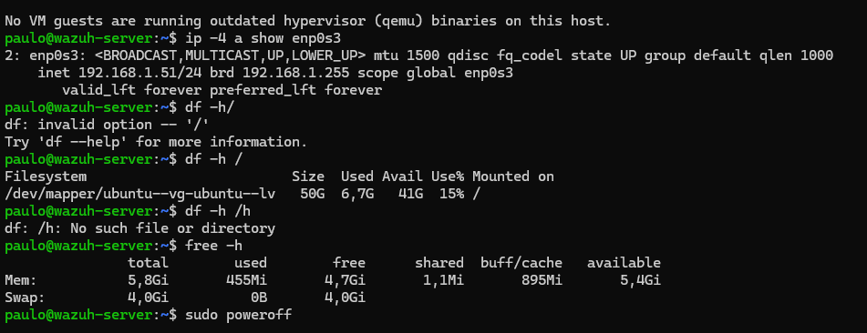
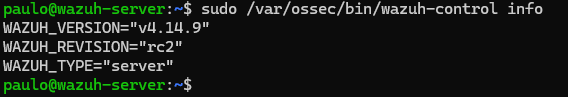
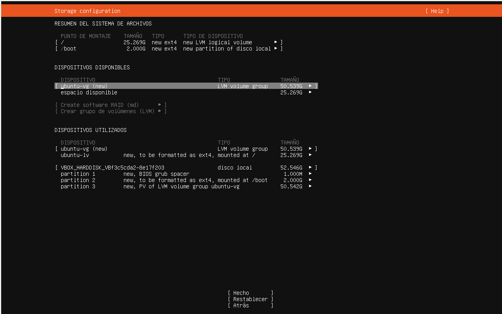
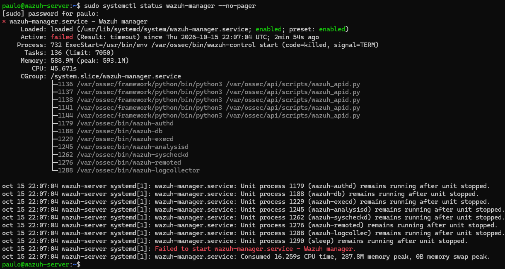

# Fase 1: Servidor Wazuh

## Objetivo

Mi objetivo para este laboratorio era, en primer lugar, tener la oportunidad de crear yo mismo el laboratorio y utilizar herramientas de monitoreo de un SOC como Wazuh, con la intención de complementar en paralelo mi formación académica.

## Arquitectura

Para la arquitectura dispuse de dos equipos: mi PC personal y un ThinkPad antiguo. El ThinkPad fue formateado para instalar Ubuntu Server y funcionar exclusivamente como servidor y endpoint del laboratorio. En mi PC personal usé VirtualBox para crear una máquina virtual con Ubuntu Server, donde instalé Wazuh. Ambos equipos se administran por SSH desde mi PC.

Como parte de la preparación inicial, configuré IPs fijas tanto para el ThinkPad como para la VM, de modo que no cambien y los agentes siempre sepan dónde encontrar al servidor.

| Equipo | Rol | SO | IP |
|---|---|---|---|
| wazuh-server (VM en VirtualBox) | Servidor Wazuh all-in-one: manager, indexer y dashboard | Ubuntu Server 24.04.5 LTS | 192.168.1.51 (fija) |
| homelab-pgt (ThinkPad L14 Gen 1) | Endpoint monitoreado con agente Wazuh | Ubuntu Server 26.04 LTS | 192.168.1.50 (fija) |
| PC anfitrión | Host de VirtualBox y administración por SSH | Windows 11 | 192.168.1.82 (DHCP) |
| Router | Gateway y DNS | — | 192.168.1.1 |

```
PC anfitrión (Windows 11 + VirtualBox)           ThinkPad
┌───────────────────────────────┐            ┌──────────────────┐
│  VM wazuh-server  .51         │◀── 1514 ───│ wazuh-agent  .50 │
│  manager · indexer · dashboard│◀── 1515 ───│                  │
└───────────────────────────────┘            └──────────────────┘
              ▲  dashboard HTTPS (443) / SSH (22)
              └──────── administración desde el PC (.82)
```

**Decisiones de red**
- **Adaptador puente (bridged) en vez de NAT:** con puente, la VM obtiene su propia IP en la red local y aparece como un equipo más, así que el ThinkPad puede enviarle eventos directamente. Con NAT, la VM quedaría oculta detrás de la IP del PC.
- **IPs fijas fuera del rango DHCP del router (.81–.219):** los agentes apuntan a la IP del manager, así que si cambiara perderían la conexión. Al dejarlas fuera del rango se evita que el router se las asigne a otro equipo (el router no permite reservas DHCP).

## Especificaciones de la VM

La VM de VirtualBox cuenta con 6 GB de RAM, 4 vCPU y 50 GB de almacenamiento dinámico. Elegí Ubuntu Server 24.04 porque está en la lista de sistemas soportados por Wazuh, y así evitaba problemas de compatibilidad. La red se configuró en modo puente (bridged).

## Instalación

### 1. Preparación
- Descarga de `ubuntu-24.04.5-live-server-amd64.iso` y verificación de integridad contra el `SHA256SUMS` oficial:
  ```powershell
  Get-FileHash .\ubuntu-24.04.5-live-server-amd64.iso -Algorithm SHA256
  ```
- Comprobación de que la IP elegida estaba libre (`ping 192.168.1.51` → "Host de destino inaccesible": nadie respondió a la consulta ARP).

### 2. Creación de la VM
- 6 GB RAM, 4 vCPU, disco de 50 GB **dinámico**, sin EFI.
- Red: adaptador puente sobre la NIC física, modo promiscuo denegado.
- Instalación desatendida **desactivada** (ver Problema 1).

### 3. Instalación de Ubuntu Server
- IP estática configurada en el propio instalador (`enp0s3`):

  | Campo | Valor |
  |---|---|
  | Subnet | 192.168.1.0/24 |
  | Address | 192.168.1.51 |
  | Gateway | 192.168.1.1 |
  | DNS | 192.168.1.1, 1.1.1.1 |

- Disco completo con LVM, ampliando `ubuntu-lv` al máximo (ver Problema 2).
- Hostname `wazuh-server`, OpenSSH server instalado.
- Actualización y verificación:
  ```bash
  sudo apt update && sudo apt upgrade -y
  hostname; ip -4 a show enp0s3; df -h /; free -h
  ```

  

- Instantánea `base-limpia`.

### 4. Instalación de Wazuh 4.14 (all-in-one)
Ejecutada dentro de `tmux` para que una desconexión SSH no interrumpiera la instalación:
```bash
tmux new -s wazuh
curl -sO https://packages.wazuh.com/4.14/wazuh-install.sh && sudo bash ./wazuh-install.sh -a
```
- Versión instalada: **4.14.9** (`sudo /var/ossec/bin/wazuh-control info`).

  

- Dashboard en `https://192.168.1.51` (certificado autofirmado generado por el instalador).

### 5. Post-instalación
Desactivación del repositorio de Wazuh para evitar actualizaciones parciales que dejen los componentes en versiones distintas:
```bash
sudo sed -i "s/^deb /#deb /" /etc/apt/sources.list.d/wazuh.list
sudo apt update
```
Verificación de servicios:
```bash
systemctl is-active wazuh-manager wazuh-indexer wazuh-dashboard
```
Instantánea `wazuh-instalado`.

## Problemas y soluciones

Durante esta fase resolví tres problemas:

### 1. Instalación desatendida de VirtualBox
- **Síntoma:** al terminar la instalación aparecieron mensajes de `cloud-init` mencionando al usuario `vboxuser`, y el hostname era `Lab-wazuh` en vez del configurado.
- **Causa:** no se marcó "Omitir instalación desatendida" al crear la VM. VirtualBox instaló Ubuntu automáticamente, con un usuario de contraseña por defecto, red por DHCP y disco sin ampliar.
- **Solución:** reinsertar la ISO en la unidad óptica virtual y reinstalar manualmente.
- **Riesgo evitado:** un usuario con contraseña conocida es una puerta de entrada trivial.

### 2. Volumen LVM sin ampliar
- **Síntoma:** en el instalador, `ubuntu-lv` (montado en `/`) tenía 25,3 GB, y quedaban otros 25,3 GB libres sin asignar en `ubuntu-vg`.
- **Causa:** el instalador de Ubuntu asigna por defecto solo una parte del grupo de volúmenes al volumen lógico raíz.
- **Solución:** editar `ubuntu-lv` en el mismo instalador y asignarle el máximo (50,5 GB). En el ThinkPad, el mismo problema se corrigió después de instalar, con `lvextend`.



### 3. Timeout del manager al arrancar
- **Síntoma:** tras reiniciar la VM, el dashboard mostraba error. `systemctl status wazuh-manager` indicaba `Active: failed (Result: timeout)` y `code=killed, signal=TERM`.
- **Diagnóstico:** los procesos de Wazuh seguían corriendo ("remains running after unit stopped"), y el pico de memoria fue de 287,8 MB sin uso de swap, lo que **descartó falta de RAM**.
- **Causa:** el manager, el indexer y el dashboard arrancan al mismo tiempo y compiten por CPU y disco; el manager superó el tiempo máximo de arranque que le da systemd.
- **Solución:** `sudo systemctl restart wazuh-manager` una vez que el indexer ya estaba activo. Se verificó con un reinicio completo que no volviera a ocurrir. Si se repite, la solución definitiva es un override con `systemctl edit wazuh-manager` y `TimeoutStartSec=300`.



## Medidas de seguridad aplicadas

- **Instantáneas (snapshots):** en la VM mantuve instantáneas de momentos limpios de la instalación: una con Ubuntu recién instalado y configurado, y otra con Wazuh ya instalado y funcionando. Así, si cometo un error grave, puedo volver atrás sin perder mucho progreso.
- **Contraseñas distintas en cada equipo:** la VM y el ThinkPad tienen contraseñas diferentes, con mayúsculas, minúsculas, números y caracteres especiales. Si una se filtra, no sirve para entrar al otro equipo (se evita el movimiento lateral).
- **Gestor de contraseñas:** implementé Bitwarden para guardar las credenciales del laboratorio (usuarios de los equipos y el administrador de Wazuh), protegido con verificación en dos pasos (2FA).
- **Verificación de la ISO:** comprobé el hash SHA-256 antes de instalar, para asegurar que la imagen no estuviera corrupta ni modificada.
- **Repositorio de Wazuh congelado:** las actualizaciones de Wazuh se hacen de forma deliberada y de todos los componentes a la vez, no con un `apt upgrade` cualquiera.

## Lo que aprendí

- Trabajar directamente con el dashboard de Wazuh: explorarlo y entender la cantidad de metadatos que se recolectan de cada evento.
- Usar una variedad de comandos de Linux para configurar la red, agregar repositorios, administrar servicios con `systemd` y verificar el estado del sistema; la gran mayoría no los había usado nunca.
- Diagnosticar un servicio caído leyendo su estado y sus logs, en lugar de reinstalar.
- La importancia de las instantáneas y de documentar cada paso.

En resumen, todo fue bastante nuevo para mí, y me deja como lección lo vasto de cada herramienta y de sus usos.
