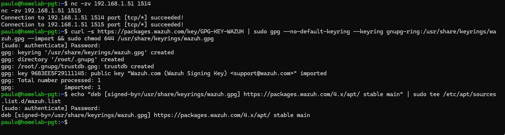
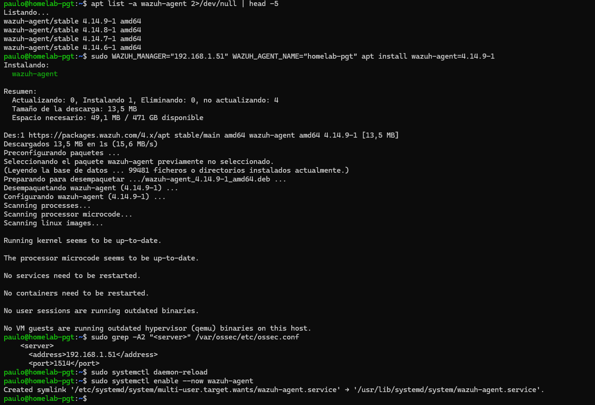
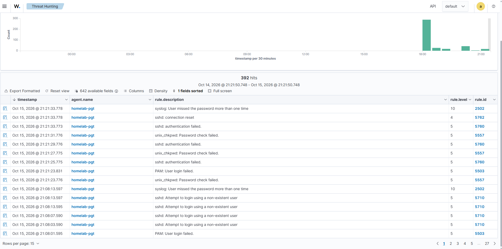
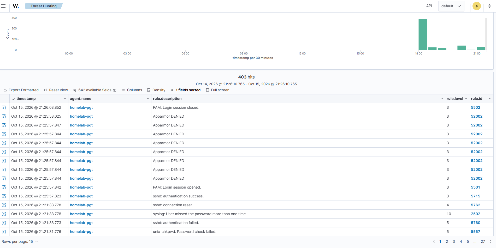

# Fase 2: Agente Wazuh en un endpoint Linux

## Objetivo

En esta fase del laboratorio, el objetivo fue conectar un equipo físico real al servidor Wazuh, para que el ejercicio fuera lo más realista y visualmente palpable posible. Así puedo asimilar conceptos y procedimientos, y reconocerlos con mayor facilidad en el futuro.

Usar un equipo real en vez de otra VM tiene una ventaja adicional: genera actividad propia (inicios de sesión, scripts del sistema, actualizaciones), no solo la que yo provoco. De hecho, el caso de estudio de AppArmor apareció sin buscarlo.

## El endpoint

| Dato | Valor |
|---|---|
| Equipo | Lenovo ThinkPad L14 Gen 1 (i5-10210U, 8 GB RAM) |
| SO | Ubuntu Server 26.04 LTS |
| Hostname | `homelab-pgt` |
| IP | 192.168.1.50 (fija, configurada con netplan) |
| Red | WiFi (`wlp4s0`) |
| Administración | SSH desde el PC |
| ID de agente | 001 |

## Cómo se comunica el agente con el manager

El **agente** es un programa liviano que se instala en cada equipo que se quiere monitorear. Lee los logs del sistema, revisa cambios en archivos y configuración, y envía todo al **manager**, que es quien analiza los eventos con sus reglas y genera las alertas.

```
ThinkPad (.50)                             wazuh-server (.51)
┌──────────────┐                          ┌───────────────┐
│ wazuh-agent  │ ── 1515: registro ─────▶ │ wazuh-authd   │
│              │ ── 1514: eventos ──────▶ │ wazuh-remoted │
└──────────────┘      (cifrados)          └───────────────┘
```

- **Puerto 1515 (`wazuh-authd`):** registro. Ocurre una sola vez: el agente se presenta con su nombre y recibe una clave única, que queda guardada en `/var/ossec/etc/client.keys`.
- **Puerto 1514 (`wazuh-remoted`):** envío continuo de eventos, cifrados con esa clave.

El agente no usa SSH; SSH solo se usa para administrar los equipos.

## Instalación del agente

### 1. Prueba de conectividad
Antes de instalar, comprobé que el ThinkPad llegaba a los puertos del manager:
```bash
nc -zv 192.168.1.51 1515
nc -zv 192.168.1.51 1514
```
Ambos respondieron `succeeded!`.

### 2. Llave GPG y repositorio de Wazuh
```bash
curl -s https://packages.wazuh.com/key/GPG-KEY-WAZUH | sudo gpg --no-default-keyring --keyring gnupg-ring:/usr/share/keyrings/wazuh.gpg --import && sudo chmod 644 /usr/share/keyrings/wazuh.gpg
echo "deb [signed-by=/usr/share/keyrings/wazuh.gpg] https://packages.wazuh.com/4.x/apt/ stable main" | sudo tee /etc/apt/sources.list.d/wazuh.list
```



### 3. Instalación con versión fijada
```bash
sudo apt update
apt list -a wazuh-agent 2>/dev/null | head -5
sudo WAZUH_MANAGER="192.168.1.51" WAZUH_AGENT_NAME="homelab-pgt" apt install wazuh-agent=4.14.9-1
```
Las variables de entorno `WAZUH_MANAGER` y `WAZUH_AGENT_NAME` hacen que el instalador escriba la configuración automáticamente. Lo comprobé en el archivo de configuración:
```bash
sudo grep -A2 "<server>" /var/ossec/etc/ossec.conf
```
```xml
<server>
  <address>192.168.1.51</address>
  <port>1514</port>
```

### 4. Arranque del servicio
```bash
sudo systemctl daemon-reload
sudo systemctl enable --now wazuh-agent
```



### 5. Repositorio congelado
```bash
sudo sed -i "s/^deb /#deb /" /etc/apt/sources.list.d/wazuh.list
sudo apt update
```

El agente quedó registrado como **001 `homelab-pgt`**, en estado **active** en el dashboard.

### Decisiones importantes

| Decisión | Por qué |
|---|---|
| Probar los puertos con `nc` antes de instalar | Para descartar problemas de red desde el principio. Si después el agente no conectaba, ya sabría que la causa no era la red |
| Fijar la versión `4.14.9-1` | El agente nunca debe ser más nuevo que el manager. Sin fijarla, `apt` habría instalado la versión más reciente del repositorio |
| Llave GPG con `signed-by` | `apt` verifica que los paquetes estén firmados por Wazuh; si alguien los modificara, la firma no coincidiría y se rechazarían. Con `signed-by`, esa llave solo es válida para el repositorio de Wazuh |
| Variables de entorno en la instalación | El instalador configura la IP del manager y el nombre del agente por sí solo, con menos edición manual y menos errores |
| Repositorio congelado | Un `apt upgrade` rutinario no cambia la versión del agente ni lo desincroniza del manager |

## Pruebas de detección

Hice de "atacante" contra mi propio equipo (simulación de adversario) para comprobar que la detección funcionaba. Todas las pruebas se hicieron desde el PC (192.168.1.82):

| # | Prueba | Alertas generadas |
|---|---|---|
| 1 | `ssh hacker@192.168.1.50` (usuario inexistente) | **5503** (PAM) · **5710** ×4 · **2502** (nivel 10) |
| 2 | `ssh paulo@192.168.1.50` con contraseña incorrecta ×3 | **5557** (unix_chkpwd) · **5503** (PAM) · **5760** (sshd) ×3 · **5762** (connection reset) · **2502** (nivel 10) |
| 3 | `ssh paulo@192.168.1.50` con contraseña correcta + `exit` | **5715** (éxito) · **5501** (sesión abierta) · **52002** ×9 (AppArmor) · **5502** (sesión cerrada) |





Consultas utilizadas en *Threat Hunting → Events*:
```
rule.id:5710
agent.name:homelab-pgt AND rule.groups:authentication*
rule.groups:authentication_failed
rule.level >= 7
```

### Análisis de las pruebas

- **Una acción, varias alertas.** Lo primero que me llamó la atención fue que una sola acción generara varias alertas distintas, cada una con su propio rule ID según el tipo de evento. Un solo intento fallido quedó registrado por tres fuentes diferentes (`unix_chkpwd`, PAM y `sshd`).

- **5710 vs. 5760.** Las alertas que más me llamaron la atención fueron la 5710 y la 5760, que corresponden a un intento de inicio de sesión con un usuario **inexistente** y con un usuario **existente**, respectivamente. La 5760 es más preocupante: indica que el atacante ya conoce una cuenta válida y solo le falta la contraseña, mientras que la 5710 suele corresponder a bots que prueban nombres comunes.

- **Correlación (2502).** La regla 2502 aparece con un nivel más alto que el resto (10) porque es una regla de **correlación**: no analiza un evento aislado, sino un patrón, en este caso un usuario que falla la contraseña varias veces seguidas. Wazuh no bloquea al usuario, solo lo detecta y eleva la gravedad para que el analista lo revise primero.

- **Logins exitosos.** Los inicios de sesión exitosos también se registran, porque pueden significar la entrada de una persona externa con credenciales reales filtradas o adivinadas. Por ejemplo, una 2502 seguida de una 5715 desde la misma IP indicaría un ataque de fuerza bruta que funcionó. Además, las reglas 5501 y 5502 marcan la apertura y el cierre de la sesión, lo que permite saber cuánto duró.

## Caso de estudio: AppArmor DENIED

Entre las alertas, una que se repetía en cada inicio de sesión exitoso fue la de **AppArmor** (regla 52002), un módulo de seguridad de Linux que limita lo que puede hacer cada programa según un perfil predefinido. Al investigarla, descubrí que el perfil del comando `who`, que el sistema ejecuta automáticamente al iniciar sesión, le impedía leer `/etc/passwd` y `/etc/nsswitch.conf`. Lo confirmé reproduciendo el evento y la clasifiqué como un *benign true positive*: el evento era real, pero no representaba una amenaza.

El análisis completo está en [Caso 01: AppArmor DENIED](casos/01-apparmor-who.md).

## Medidas de seguridad aplicadas

- **Integridad de los paquetes:** llave GPG oficial de Wazuh asociada solo a su repositorio (`signed-by`).
- **Versión controlada:** el agente quedó en la misma versión que el manager, con el repositorio congelado.
- **Protección de la clave del agente:** `client.keys` se trata como un secreto y está incluido en el `.gitignore` del repositorio.
- **Cambios verificados:** conectividad comprobada antes de instalar, y configuración revisada antes de arrancar el servicio.
- **Pruebas controladas:** las simulaciones de ataque se hicieron solo contra mi propio equipo y dentro de mi red.

## Lo que aprendí

- Ver e interactuar directamente con el dashboard de Wazuh, y descubrir que tiene módulos para distintas tecnologías, como Docker o los principales proveedores de nube.
- La variedad de alertas y metadatos que genera una sola acción, y cómo buscarlos con filtros por grupo, nivel, agente o IP.
- Clasificar alertas: *true positive*, *benign true positive* y *false positive*.
- Hacer un triage completo: observar, recoger contexto, formular una hipótesis, comprobarla y clasificar.
- La importancia de las zonas horarias al analizar logs: el ThinkPad registra en UTC y el dashboard muestra la hora de Chile.
