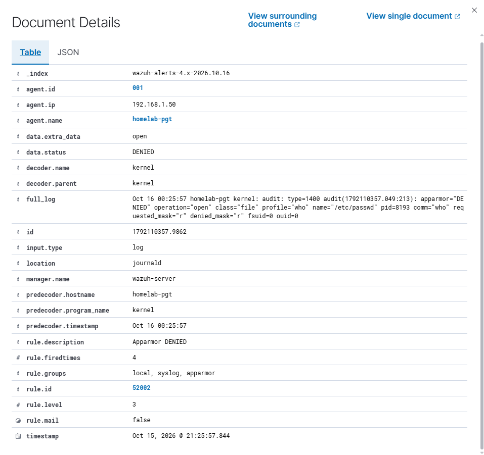
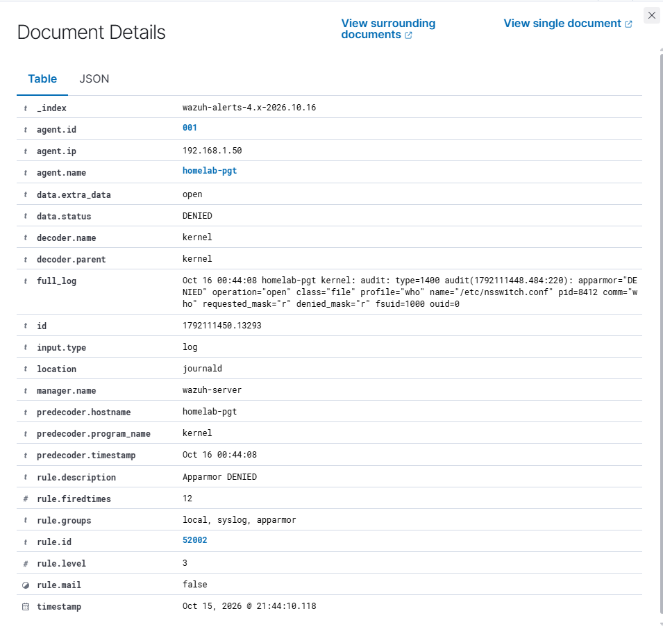

# Caso 01: AppArmor DENIED al iniciar sesión

| Agente | Regla | Clasificación |
|---|---|---|
| homelab-pgt (Ubuntu 26.04) | 52002 · nivel 3 | Benign true positive |

## Qué se observó

Al revisar el dashboard de Wazuh después de las pruebas de inicio de sesión, se observaron 9 alertas de AppArmor en el mismo instante, justo después de un login exitoso. Todas correspondían al programa `who`.

## Evidencia

Alerta original, generada automáticamente al iniciar sesión:
```
apparmor="DENIED" operation="open" class="file" profile="who" name="/etc/passwd" comm="who" requested_mask="r" denied_mask="r" fsuid=0
```



Alerta reproducida, al ejecutar `who` manualmente:
```
apparmor="DENIED" operation="open" class="file" profile="who" name="/etc/nsswitch.conf" comm="who" requested_mask="r" denied_mask="r" fsuid=1000
```



| Campo | Alerta original | Alerta reproducida | Significado |
|---|---|---|---|
| `comm` / `profile` | `who` | `who` | Programa bloqueado y perfil de AppArmor que lo bloqueó |
| `operation` | `open` | `open` | Intento de abrir un archivo |
| `name` | `/etc/passwd` | `/etc/nsswitch.conf` | Archivo al que intentó acceder |
| `denied_mask` | `r` | `r` | Permiso denegado: lectura |
| `fsuid` | `0` (root) | `1000` (paulo) | Usuario que ejecutaba el programa |

## Investigación

Al ver los logs en detalle, identifiqué un programa en común, `who`, que era el que AppArmor estaba bloqueando. Mi hipótesis fue que el sistema ejecuta `who` automáticamente al iniciar sesión (los scripts del mensaje de bienvenida lo usan para mostrar los usuarios conectados), y por eso las alertas aparecían justo después de cada login exitoso.

Para comprobarlo, ejecuté `who` manualmente en el ThinkPad, y apareció una nueva alerta 52002 del mismo programa. Esto confirmó que el bloqueo depende del **programa** y no de la cuenta: se produjo tanto al ejecutarse como root (`fsuid=0`) como con mi usuario (`fsuid=1000`). AppArmor limita lo que puede hacer cada programa según su perfil, de forma independiente de los permisos del usuario.

La causa probable es un perfil de AppArmor demasiado estricto en Ubuntu 26.04, ya que `who` es un programa legítimo del sistema y solo intentaba leer archivos públicos (`/etc/passwd` no contiene contraseñas y cualquier usuario puede leerlo). Por eso el evento se clasifica como *benign true positive*: el bloqueo fue real, pero no representa una amenaza.
